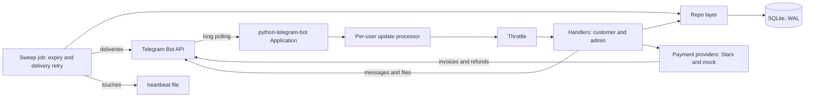
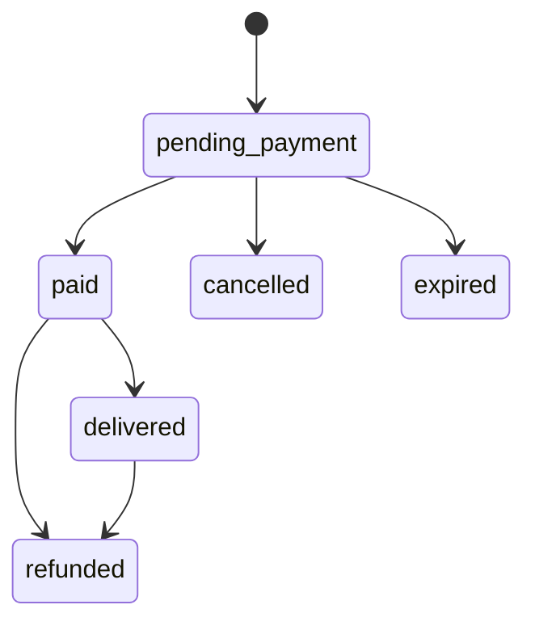
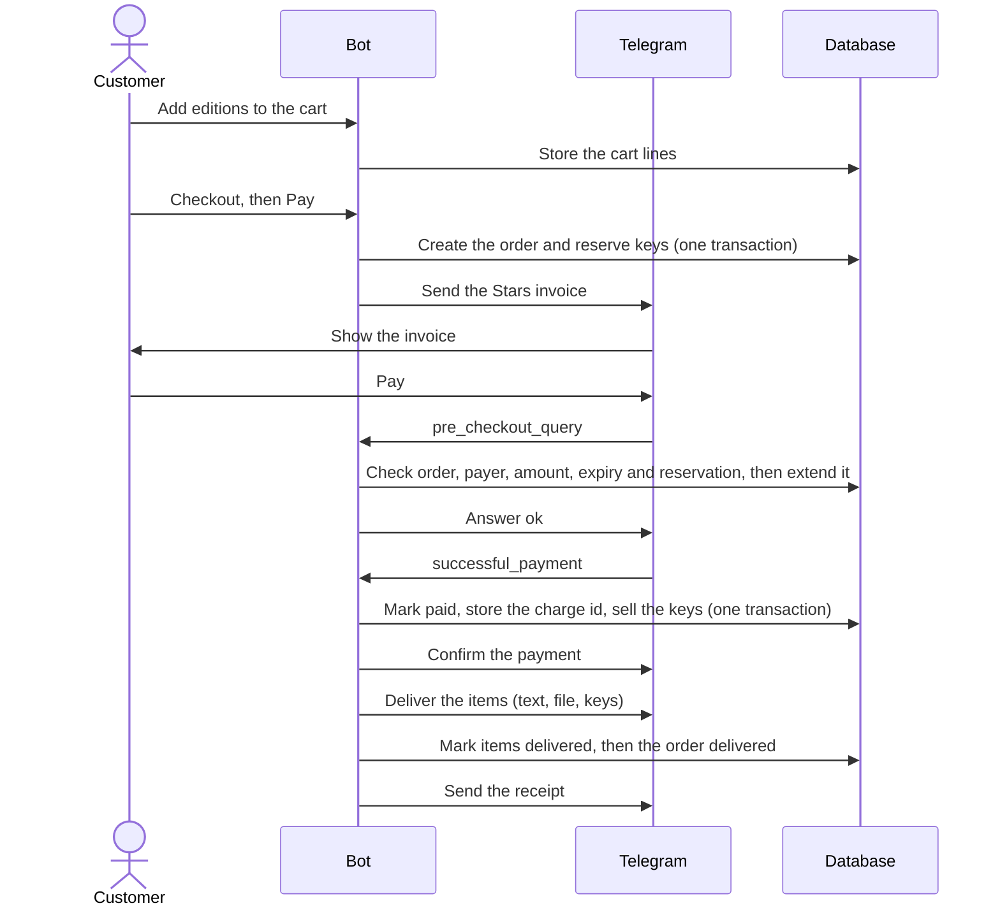

# Numinae Store

[](https://github.com/NUMINAE/numinae-store-bot/actions/workflows/ci.yml)
[](LICENSE)
[](pyproject.toml)

A Telegram storefront for digital goods — files, licence keys and text — paid with Telegram Stars. It is a portfolio project: "Numinae Store" and everything in its demo catalogue are fictional.

## Features

- **Catalogue.** Categories contain products; each product has editions that are delivered as text, as a file, or as licence keys.
- **Cart and checkout.** A cart with quantity limits (keys up to the available stock, one per customer for text and files), a review step, and one open order per customer. An order may not exceed 25,000 Stars, Telegram's invoice limit.
- **Stars payments.** Native Telegram Stars invoices (currency `XTR`), pre-checkout validation and payment confirmation. Licence keys are reserved for a configurable window (default 15 minutes) while the order awaits payment.
- **Demo mode.** A mock payment mode that runs the same internal completion path with a "Pay (demo)" button. See [Payment modes](#payment-modes) for its warning.
- **Delivery.** Text, files and keys are sent in the chat after payment, retried automatically if sending fails, split over several messages when long, and finished with a receipt. Purchases stay in **My Library**, where items can be sent again.
- **Late and duplicate payments.** A payment that arrives for an expired, cancelled or already-paid order is refunded automatically.
- **Owner tools** (`/admin`): catalogue management, file and licence-key uploads, orders with cancel / retry delivery / resend / refund, statistics and settings. The owner is also notified of new customers and of payments that need attention.
- **Design language.** Every screen shares one layout (header, breadcrumbs, steps, a Back/Home row) and one icon table.
- **Operations.** A backup command, `--check-config` and `--healthcheck` flags, a Dockerfile and a Docker Compose file.

## Quick start

Python 3.11 or newer and SQLite 3.35 or newer are required (migration 0004 uses `ALTER TABLE ... DROP COLUMN`). The bot is English-only.

You need a bot token from [@BotFather](https://t.me/BotFather) (send `/newbot`) and your numeric Telegram user id (message [@userinfobot](https://t.me/userinfobot)).

**PowerShell**

```powershell
Copy-Item .env.example .env        # then edit .env: set BOT_TOKEN and OWNER_ID
python -m venv .venv
.\.venv\Scripts\Activate.ps1
pip install -e .
python -m bot.main
```

**bash**

```bash
cp .env.example .env               # then edit .env: set BOT_TOKEN and OWNER_ID
python -m venv .venv
source .venv/bin/activate
pip install -e .
python -m bot.main
```

`.env.example` starts in **mock mode** with the demo catalogue, which is right for trying the bot locally and wrong for anything else: see [Payment modes](#payment-modes). On first run the bot creates `data/shop.db` and applies the numbered migrations in `bot/migrations/`; later runs apply only new migrations. Then open your bot in Telegram and send `/start`; the owner account also has `/admin`.

## Configuration

Settings are read from environment variables, or from a `.env` file in the working directory. A missing or invalid value stops the bot with a message that names the variable and never prints any value.

| Variable | Required | Default | Meaning |
|---|---|---|---|
| `BOT_TOKEN` | yes | — | The bot token from @BotFather. Never logged; redacted from logs and tracebacks. |
| `OWNER_ID` | yes | — | The numeric Telegram user id of the shop owner. Only this account can use the admin tools. |
| `PAYMENT_MODE` | yes | — | `stars` for real Telegram Stars payments, or `mock` for the demo mode. There is deliberately no default. |
| `DB_PATH` | no | `data/shop.db` | The SQLite database file. The data directory also holds the heartbeat file and, by default, backups. |
| `LOG_LEVEL` | no | `INFO` | `DEBUG`, `INFO`, `WARNING`, `ERROR` or `CRITICAL`. The `telegram`, `httpx` and `httpcore` loggers never go below `INFO` / `WARNING` whatever this says. |
| `SEED_DEMO` | no | `false` | `true` loads a fictional demo catalogue into an empty database. `.env.example` sets it to `true`; turn it off before adding real content. |

`python -m bot.main --check-config` checks the configuration and prints `config ok, mode=<mode>` without touching the database or the network.

## Payment modes

`PAYMENT_MODE` selects how checkout takes payment:

- **`stars`** — real Telegram Stars payments. The bot sends an invoice. The order is only marked paid, and goods are only delivered, after Telegram's `successful_payment` update.
- **`mock`** — a demo. Checkout shows an order summary under a "DEMO MODE" banner with a "Pay (demo)" button that runs the same completion path as a real payment, but no money moves.

> **Warning:** `mock` grants real content without payment. Anyone who can reach the bot can "pay" for anything and receive licence keys and files for free. Never run it with real content; use `stars` for a real shop. At startup mock mode logs one warning.

Orders keep the mode they were created in; an order from another mode is cancelled instead of resumed when the mode changes.

## Architecture



The bot uses long polling in a single process with one SQLite connection. Updates from different users run concurrently while one user's updates stay in order (see [Concurrency](#concurrency)); every database section is synchronous, so a transaction is never open across an `await`.

## Order lifecycle



An order starts as `pending_payment` with its licence keys reserved. It becomes `paid` when Telegram confirms the payment, and `delivered` when every item has been sent. Unpaid orders are `cancelled` by the customer or the owner, or `expired` by the sweep, which releases the reserved keys. A paid or delivered order can be `refunded`, which revokes its sold licence keys. Status changes happen only through `repo.orders.set_status`, which rejects any other transition.

## Purchase flow



In mock mode the invoice, pre-checkout and `successful_payment` steps are replaced by the "Pay (demo)" button, which runs the same recording and delivery steps.

## Concurrency

python-telegram-bot handles updates one at a time by default, so one slow handler would delay everyone, including a payment's `pre_checkout_query`, which Telegram wants answered within 10 seconds. The bot therefore uses `PerUserUpdateProcessor` (`bot/concurrency.py`):

- **Different users run concurrently** (up to 256 updates at once); **one user's updates run strictly in order**, each behind a per-user lock. A slow owner action such as `/sweep` delays only the owner's own later updates, never customers'.
- **At most 8 updates per user** may be queued or in flight; a flood beyond that is dropped immediately, and the drops are reported in one log line per user per minute with only the user id and a count. PTB takes a slot from its shared pool *before* the processor runs (the semaphore is acquired in the final `process_update`, then `do_process_update` is called), so the cap is what stops one user's queued updates from holding pool slots.
- A `pre_checkout_query` is never dropped and **bypasses the per-user lock**, so it is always answered promptly. That is safe because the handler has no `await` between `check_payable` and `extend_reservation`, and no `await` ever happens while a database transaction is open (both are checked by tests that read the source), so it cannot interleave with another handler's database work.
- A `successful_payment` is never dropped and **stays inside the lock**, so a user's payment is recorded before any later update of theirs (for example a cancel) is processed.

## Security design

Each property below names the tests that enforce it.

- **Ownership, with identical responses.** Orders and library items reached by id go through `get_owned_order`; a stranger's id and a nonexistent id get the same answer, so ids cannot be probed. Admin routes are owner-only, and documents or media from anyone else store and download nothing. Tests: `tests/test_callback_security.py`, `tests/test_admin_uploads.py`.
- **Escaping at render time.** Names, descriptions, delivery content and owner-entered text are stored raw and escaped once when rendered; hostile markup is tested on screens, deliveries and notices. Tests: `tests/test_escaping.py`, `tests/test_delivery_escaping.py`, `tests/test_render.py`.
- **Messages that fit.** Raw text is trimmed before escaping and sized by its escaped length, so screens stay under Telegram's 4096-character limit even for hostile content, and paid content is split across messages, never cut. Tests: `tests/test_screens.py`, `tests/test_ui_kit.py`.
- **Parameterised SQL with fixed fragments.** Every query passes values as parameters; the few f-string queries interpolate only constant or whitelisted fragments, and each carries a reasoned lint exception. This is enforced by the `S` rules of `ruff` (see `pyproject.toml`) in CI, not by a dedicated test.
- **Token redaction.** The bot token is wrapped in a secret type, redacted from every log line and from uncaught tracebacks, and kept out of `telegram` / `httpx` debug logging; logs never contain message text, key values or update objects. Tests: `tests/test_redact.py`, `tests/test_hardening.py`.
- **Throttling and per-user concurrency.** Per-user rate limiting that never blocks payment updates, plus the per-user update processor described above. Tests: `tests/test_ratelimit.py`, `tests/test_throttle_payments.py`, `tests/test_concurrency.py`.
- **Idempotent payments.** The payer, amount, currency and order state are checked at pre-checkout and again when the payment is recorded; a repeated charge id is a duplicate, and a payment for a dead order is refunded using the incoming charge id. Tests: `tests/test_payment_checks.py`, `tests/test_payment_completion.py`, `tests/test_payment_handlers.py`.
- **Atomic transactions.** Compound writes run in one transaction, and a test reads the source to prove no `await` appears inside a transaction block. Tests: `tests/test_ast_safety.py`, `tests/test_payment_completion.py`.
- **One key, one order.** A licence key row belongs to at most one order item, is claimed under `BEGIN IMMEDIATE`, and only sold from the reserved state. Tests: `tests/test_order_creation.py`, `tests/test_license_keys.py`.
- **No unsafe default.** `PAYMENT_MODE` has no default, so the demo mode can never be selected by omission. Tests: `tests/test_config.py`, `tests/test_hardening.py`.
- **Owner-only files on POSIX.** The data directory is created `0700` and the database files are set to `0600` on a best-effort basis. Test: `tests/test_permissions.py` (skipped on Windows, where file modes do not apply).

Security reports: see [SECURITY.md](SECURITY.md).

## Data and privacy

The bot stores the minimum needed to sell and deliver goods:

- **Per customer:** Telegram user id, username and first name (as Telegram supplies them), and first/last seen times.
- **Per order:** the user id, items with names and prices, status history, and the Telegram payment charge id. Carts and unfinished admin input are stored by user id.
- **Licence keys are stored in plaintext**, linked to the order they were sold to, because they must be delivered again on request. Delivery text and Telegram file ids (references, not file contents) are also stored.

Nothing is sent to anyone except Telegram. Logs contain user ids, order ids and payment charge ids but never the bot token, message text or key values. Treat the database, its `-wal` and `-shm` files, backups and logs as sensitive: restrict their permissions and encrypt backups.

There is no built-in erasure tool. To honour a deletion request by hand, remove the person's rows from `customers`, `cart_items` and `admin_pending_input`, and anonymise their `orders`, keeping whatever records you are legally required to keep. Do it while the bot is stopped, or after taking a backup.

## Admin guide

Everything below is done from the owner's account with `/admin`.

**Uploading files.** Open an edition of kind *File* in the catalogue manager and tap *Upload file* (or *Replace file*), then send the file as a **File** (paperclip → File), not as a photo or video, so Telegram keeps it unchanged. The bot stores only Telegram's `file_id` and the file name — nothing is downloaded. Replacing the file changes what existing buyers get when they re-download from their library. Telegram file ids are scoped to the bot, so **if you change the bot token you must upload every file again**.

**Adding licence keys.** Open an edition of kind *Key* and tap *Add keys*, then either paste the keys as a message or send a `.txt` file. One key per line; blank lines are ignored; spaces inside a key are fine. A line is rejected if it is longer than 200 characters or contains a control character. Duplicates (within the batch or already in stock) are skipped. At most 5000 keys per batch, and a `.txt` file may be at most 256 KB, UTF-8. The bot replies with counts and the numbers of rejected lines (at most ten) — it never repeats key text. The edition card shows stock as available / reserved / sold / revoked.

**Orders.** *Orders* lists orders by filter (*Needs attention* is paid orders with an undelivered item); `/order <id>` opens one directly. The order card shows the buyer, timestamps, items, payment details and recent events, with actions by status: *Cancel order* (pending; releases the reserved keys, the buyer's cart is not restored), *Retry delivery* (paid), *Resend to buyer* (delivered) and *Refund*.

**Refunds.** *Refund* returns the full amount to the buyer. For a Stars order Telegram is asked first, and the order is only marked refunded if that succeeds; a mock order never reaches Telegram. Refunding revokes the order's **sold licence keys** so they can never be sold again. Text and files that were already delivered **cannot be unsent**. The buyer is told. If Telegram refunds the money but the bot cannot record it, you get an alert with the charge id so you can reconcile by hand.

**Stats.** Real (Stars) and demo (mock) figures are always shown separately. For each window, *gross* is the total of orders paid in that window (including ones refunded since), *refunded* is the total of orders refunded in that window, and *net* is gross minus refunded. A refund counts in the window it happened in, so a refund of an older sale can make the last 7 days' net negative. Windows are the last 7 days and all time. Top editions are units sold from paid or delivered orders, per payment mode.

## Operations

### Docker

```bash
cp .env.example .env               # set BOT_TOKEN and OWNER_ID; set PAYMENT_MODE=stars for a real shop
docker compose up -d --build
docker compose logs -f bot
```

The image is built in two stages (a wheel in the builder, only the wheel in the runtime image) and runs as the unprivileged user `10001`. The database lives in the named volume `numinae-data`, mounted at `/app/data`. The Compose file runs the container with a read-only root filesystem, no Linux capabilities, `no-new-privileges`, an init process, and no published ports; each option is explained in `docker-compose.yml`. No `.env` file or secret is copied into the image. CI builds the image and starts it under the same restrictions as the Compose file (read-only root filesystem, `/tmp` as tmpfs, no capabilities, `no-new-privileges`, a fresh named volume) with a fake token: it checks that the bot starts, applies its migrations, creates `data/shop.db` owned by uid 10001, and exits with code 1 when Telegram rejects the token, with no permission errors and nothing token-shaped in the output. What CI does not exercise is a graceful stop or long-running behaviour under Compose; those are designed for, not tested.

**Run exactly one instance.** Two bots polling with the same token fight over `getUpdates`, and the in-memory guards (rate limiting, in-flight delivery and refund guards, the per-user update processor) are per process.

### Backups

`python -m bot.backup [--db PATH] [--out DIR] [--keep N]` writes an integrity-checked copy of the database to `<out>/shop-YYYYMMDD-HHMMSS.db` (UTC; default `<db dir>/backups`) using SQLite's online backup API, so it is safe while the bot runs, and keeps the newest N (default 14), pruning only files with that exact name pattern. It needs no `BOT_TOKEN`. With Docker, back up a running container with:

```bash
docker compose exec bot python -m bot.backup
```

The copy lands in the same volume (`/app/data/backups`), which protects against a bad edit but not against losing the machine, so copy it somewhere else (for example with `docker compose cp bot:/app/data/backups ./backups`; that command is untested).

> **Backups contain plaintext licence keys.** Store them encrypted and off the machine.

### Upgrading

Upgrading is automatic: start the new version and it applies any new numbered migrations in order. Applied migrations are checksummed and never edited, so a tampered migration stops the bot at startup. Migrations only go forward; take a backup before upgrading.

### Shutdown

SIGTERM and SIGINT (Ctrl+C) make python-telegram-bot stop gracefully (checked in its source): it stops fetching updates, then waits for every in-flight update and every background task, including deliveries, to finish. It cancels nothing and has no timeout of its own, so **a hung handler delays shutdown**. `docker stop` is designed to deliver SIGTERM to Python (the `CMD` is in exec form and Compose runs an init process), but that has not been tested here. Docker is expected to kill the container with SIGKILL once `stop_grace_period` (30 s in `docker-compose.yml`) runs out, so raise it if your handlers or deliveries can take longer. An order left `paid` because a delivery was interrupted is retried by the recurring sweep (every minute, with no remembered backoff after a restart) until it is delivered.

### Heartbeat and healthcheck

The sweep touches `<db dir>/heartbeat` at the start of every pass. `python -m bot.main --healthcheck` exits 0 when that file is at most 180 seconds old, and otherwise exits 1 with one line (`no heartbeat` or `stale heartbeat Ns`); it needs no token. The Docker image runs it as its `HEALTHCHECK` (every 60 s, 90 s start period, 3 retries). **It proves that the event loop and the job queue are running. It does not prove that Telegram is reachable or that the token is valid.** Docker is expected to only report the container as unhealthy, so act on that with your own monitoring.

## Known limitations

- **Update acknowledgement.** *Verified in the python-telegram-bot source:* fetched updates are acknowledged to Telegram when PTB queues them, not when they are processed. A graceful stop (SIGTERM or SIGINT, `docker stop`) drains the queue and background deliveries first. *Consequence:* a hard kill (SIGKILL, power loss, out-of-memory) between fetch and handling can lose a `successful_payment`: the customer is charged, nothing is recorded, the order expires, and no refund is issued. The exposure is the time an update spends queued or in a handler. Recovery today is manual; a reconciliation job using `Bot.get_star_transactions` (whose `id` matches the payment charge id) is on the [Roadmap](#roadmap). Mitigation: run under a supervisor that sends a graceful stop, and keep `stop_grace_period` long enough to drain. *Assumed, not verified:* the exact moment Telegram's server drops confirmed updates, and that `docker stop` produces a graceful stop in the container (the exec-form `CMD` and PTB's signal handling are designed for it).
- **Healthcheck scope.** It shows the event loop and job queue are alive, not that Telegram is reachable or the token is valid.
- **Short-key payments.** If a customer pays after their key reservation lapsed and the keys were taken, the order is recorded as paid with fewer keys than needed. The owner is alerted and must refund or add keys by hand.
- **Partial deliveries repeat parts.** Long text and long key lists are sent as several messages, and an item counts as delivered only after all parts are sent. If a part fails, a retry sends the item again from its first part, repeating parts the customer already received.
- **Refunds cannot unsend.** Delivered text and files cannot be taken back after a refund. Licence keys are revoked in the shop's records, but the customer still holds the text they were sent. A refund issued while a delivery is in flight can leave the customer with some or all of the goods and a refund.
- **Telegram file ids are bot-scoped.** Changing the bot token means uploading every delivery file again.
- **One process, one SQLite database.** There is no horizontal scaling, and running two instances is not supported.
- **Polling only.** There is no webhook mode.
- **Hung handlers delay shutdown.** See [Shutdown](#shutdown).
- **Stars mode** has not been exercised with real Stars beyond invoice creation; see [Verification status](#verification-status).
- **No built-in erasure tool** for customer data; see [Data and privacy](#data-and-privacy).
- **Dependencies are version-bounded, not locked.** Installs can pick up newer compatible releases; a weekly CI audit checks for known vulnerabilities.
- **English only.**

## Roadmap

Optional ideas, not commitments:

- **Stars transaction reconciliation:** a job that compares `Bot.get_star_transactions` with recorded payments, to recover a payment lost to a hard kill.
- **A customer erasure command** for the owner.
- **Webhook mode.**

## Verification status

Stars mode: invoice creation has been checked against live Telegram. Pre-checkout, payment confirmation and refunds are covered by automated tests against python-telegram-bot's types but have not been exercised with real Stars. Mock mode exercises the same internal payment path end to end.

## Project layout

```
bot/
  main.py          entrypoint, logging, handler registration, health flags
  config.py        settings from the environment / .env
  dbpath.py        DB_PATH alone, for the backup and health commands
  db.py            connection and the numbered-migration runner
  migrations/      0001_init.sql, ... applied in filename order
  seed_demo.py     optional demo catalogue (seed_demo.json)
  concurrency.py   per-user update processing
  health.py        heartbeat file and the --check-config / --healthcheck flags
  backup.py        the database backup command
  delivery.py      sending purchased goods
  refunds.py       admin refunds (provider first, then the database)
  stats.py         the numbers behind the Stats screen
  keyparse.py      parsing pasted or uploaded licence keys
  redact.py        keeping the bot token out of logs
  ratelimit.py     per-user throttling
  jobs.py          the recurring sweep and /sweep
  payments/        Stars and demo providers, the shared payability check
  limits.py        shared limits (the 25,000 Star order cap)
  tg.py            typed access to optional update fields
  security.py      owner_only decorator and get_owned_order
  render.py        HTML escaping and Stars formatting
  keyboards.py     reply keyboard and callback-data helpers
  i18n.py          customer-facing strings (t / tn) and the icon placeholders
  ui_kit.py        the design language: ICON, screen(), nav_row(), pager(), trimming
  summary.py       order / cart summary lines shared by checkout, payment and receipt
  profile.py       the bot's Telegram profile: command menus and descriptions
  repo/            query functions
  handlers/        command and callback handlers
tests/             the test suite
Dockerfile         two-stage image, non-root user
docker-compose.yml one hardened service and a named data volume
data/              gitignored, created at runtime
```

## Development

```bash
pip install -e ".[dev]"                       # the bot plus dev tools
pytest --cov --cov-fail-under=0               # tests with coverage
coverage report --omit="bot/handlers/*" --fail-under=80
coverage report --include="bot/handlers/*" --fail-under=60
ruff check . && ruff format --check . && mypy
```

Coverage measures line and branch coverage of the `bot` package. Handlers have a lower threshold than the rest; `bot/main.py` is excluded from measurement. See [CONTRIBUTING.md](CONTRIBUTING.md) for migration rules and project conventions, and [CHANGELOG.md](CHANGELOG.md) for what changed.

Optional: `pre-commit install` runs ruff and basic file checks before each commit.

## License

[MIT](LICENSE) © 2026 NUMINAE
